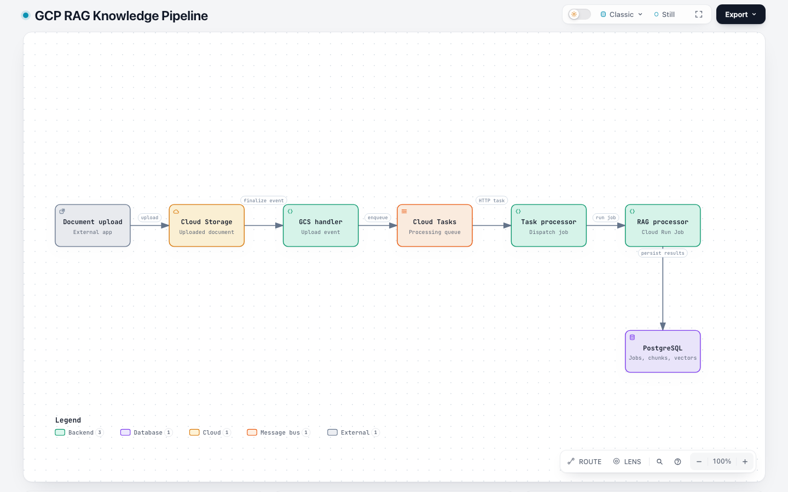
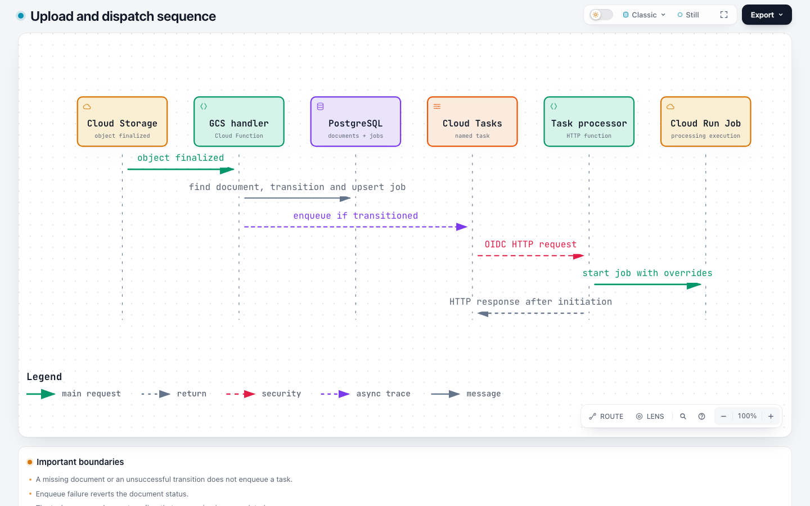
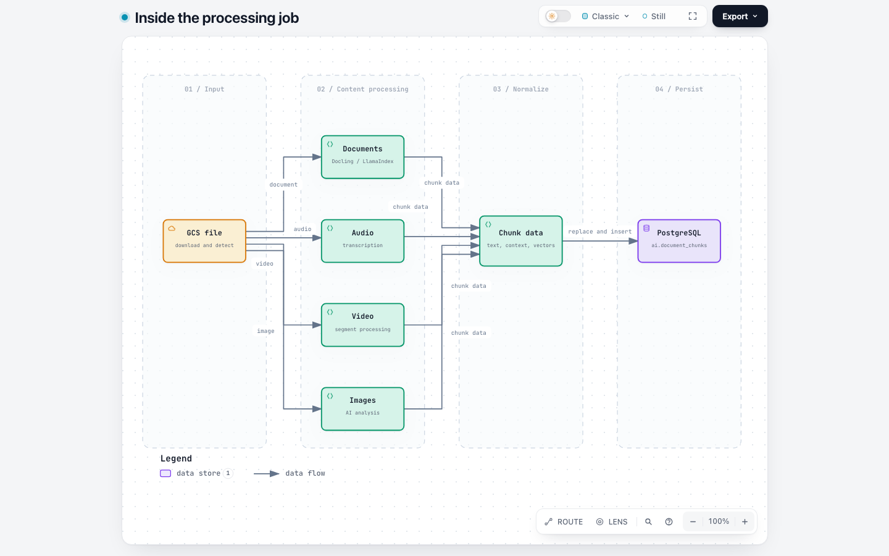

# GCP RAG Knowledge Pipeline

A standalone repository for the RAG (Retrieval Augmented Generation) document processing pipeline extracted from a larger application monorepo.

## Technology stack

| Area | Technologies and role |
| --- | --- |
| Runtime and validation | Python, `asyncio`, Pydantic, HTTPX, and Structlog for processing jobs, typed data, HTTP calls, and structured logs. |
| Document parsing and chunking | LlamaIndex (default document processor), optional LlamaParse for PDFs, Docling / HybridChunker as an alternative, and LangChain text splitters. |
| AI and embeddings | Google Gen AI SDK and Vertex AI SDK; `gemini-2.5-flash` for transcription and media analysis, `gemini-embedding-001` for text embeddings, and `multimodalembedding@001` for multimodal embeddings. These are the source configuration defaults. |
| Media processing | FFmpeg, Pydub, OpenCV, and Pillow for audio, video, and image handling; PyTorch and Transformers support the document processing ML dependencies. |
| Data storage | PostgreSQL with pgvector, accessed through Psycopg2, stores chunks, vectors, document metadata, and processing status. |
| GCP execution and events | Cloud Storage, Eventarc, Cloud Functions (2nd gen), Cloud Tasks, and Cloud Run Jobs handle uploads, event delivery, queued dispatch, and processing executions. Functions Framework and CloudEvents provide the function entry points. |
| GCP operations and delivery | Secret Manager, Cloud Logging, IAM / OIDC, Cloud Build, and Artifact Registry provide credentials, logs, access control, container builds, and image storage. |
| Developer tooling | `uv`, Docker, GitHub Actions, Ruff, mypy, and pytest support dependency management, packaging, deployment automation, linting, type checks, and tests. |

The stack is defined in the [processor dependencies](apps/rag-processor/pyproject.toml), [GCS handler dependencies](apps/rag-gcs-handler/pyproject.toml), [task processor dependencies](apps/rag-task-processor/pyproject.toml), and [processor configuration](apps/rag-processor/rag_processor/config.py).

## Overview

This repository contains three core RAG processing applications:
- **rag-processor**: Cloud Run Job for document processing, chunking, and embedding generation
- **rag-gcs-handler**: Cloud Function triggered by GCS uploads to create processing jobs
- **rag-task-processor**: Cloud Function to manage and schedule processing tasks

## Architecture

<picture>
  <source media="(prefers-color-scheme: dark)" srcset="artifacts/archify/evidence-visual/rag-architecture.visual-check.1440x900.dark.png">
  
</picture>

[Open the interactive architecture diagram](artifacts/archify/rag-architecture.html) · [Read the flow and source guide](artifacts/archify/README.md)

1. An upstream application uploads a document to Cloud Storage. The GCS handler finds its existing `ai.documents` record, transitions an `uploading` document to `processing`, and creates or updates a processing job.
2. For a successful transition, the handler enqueues a Cloud Task. The task processor starts a Cloud Run Job and returns after initiation; the response does not indicate that document processing has completed.
3. The RAG processor validates program ownership, downloads the file, and routes documents, audio, video, or images to the appropriate processor. It generates embeddings and stores chunks and processing status in PostgreSQL.

The diagram describes the repository's source architecture; it is not a verification of a live deployment.

### Upload and dispatch

<picture>
  <source media="(prefers-color-scheme: dark)" srcset="artifacts/archify/details/dispatch-images-clean/dispatch-sequence.visual-check.1440x900.dark.png">
  
</picture>

[Open the interactive dispatch sequence](artifacts/archify/details/dispatch-sequence.html)

The handler enqueues a task only after the document transitions from `uploading` to `processing`. A missing document or unsuccessful transition does not enqueue a task; an enqueue failure reverts the document status. The task processor's HTTP response confirms job initiation, not completion. See the [handler](apps/rag-gcs-handler/main.py) and [task processor](apps/rag-task-processor/main.py).

### Inside the processing job

<picture>
  <source media="(prefers-color-scheme: dark)" srcset="artifacts/archify/details/processing-images-clean/processing-flow.visual-check.1440x900.dark.png">
  
</picture>

[Open the interactive processing diagram](artifacts/archify/details/processing-flow.html)

The job downloads the object and selects a processor for its content type. Documents use the configured Docling or LlamaIndex service; audio, video and images follow their own processing paths. The resulting chunk data can include text, context and text or multimodal embeddings. When chunks are stored for a document, existing chunks are replaced within the storage transaction; an empty chunk list skips storage. See [processing](apps/rag-processor/rag_processor/services/processing_service.py) and [chunk storage](apps/rag-processor/rag_processor/services/database_service.py).

This repository implements ingestion and storage. Retrieval and answer generation are outside the application code shown here.

## Quick Start

### Prerequisites
- Python 3.11+
- `uv` package manager
- GCP project with enabled APIs:
  - Cloud Run
  - Cloud Functions
  - Cloud Storage
  - Cloud Build
  - Vertex AI

### Local Development

```bash
# Install dependencies for an app
cd apps/rag-processor
uv sync --all-groups

# Run linting and type checking
uv run ruff check .
uv run mypy .

# Format code
uv run ruff format .
```

### Deployment

```bash
# Deploy to development environment
cd scripts
uv run python -m deploy_rag_processor_dev
uv run python -m deploy_gcs_handler_dev
uv run python -m deploy_task_processor_dev

# Deploy to production environment
uv run python -m deploy_rag_processor_prod
uv run python -m deploy_gcs_handler_prod
uv run python -m deploy_task_processor_prod
```

## Environment Configuration

Each application requires specific environment variables. See `.env.example` files in each app directory:
- `apps/rag-processor/.env.example` - RAG processor configuration
- `apps/rag-gcs-handler/.env.example` - GCS handler configuration
- `apps/rag-task-processor/.env.example` - Task processor configuration

For local development, copy `.env.example` to `.env.local` and fill in actual values:
```bash
cp apps/rag-processor/.env.example apps/rag-processor/.env.local
```

## CI/CD Workflows

GitHub Actions automatically deploys changes to dev/prod environments:

### Triggered Workflows
- **rag-processor-dev.yml**: Deploys to Cloud Run when `apps/rag-processor/` changes
- **rag-processor-prod.yml**: Deploys to Cloud Run with tag triggers
- **gcs-handler-dev.yml**: Deploys Cloud Function when `apps/rag-gcs-handler/` changes
- **gcs-handler-prod.yml**: Deploys Cloud Function with tag triggers
- **task-processor-dev.yml**: Deploys Cloud Function when `apps/rag-task-processor/` changes
- **task-processor-prod.yml**: Deploys Cloud Function with tag triggers

### Required GitHub Secrets
```
# Development
GCP_SA_KEY_DEV              # GCP Service Account JSON key
GCP_PROJECT_ID_DEV          # GCP Project ID for dev
DATABASE_URL_DEV            # PostgreSQL connection string for dev
GEMINI_API_KEY              # Google Gemini API key

# Production
GCP_SA_KEY_PROD             # GCP Service Account JSON key
GCP_PROJECT_ID_PROD         # GCP Project ID for prod
DATABASE_URL_PROD           # PostgreSQL connection string for prod
GEMINI_API_KEY_PROD         # Google Gemini API key for prod
```

## Project Structure

```
gcp-rag-knowledge-pipeline/
├── .github/
│   └── workflows/           # GitHub Actions CI/CD workflows
│       ├── rag-processor-dev.yml
│       ├── rag-processor-prod.yml
│       ├── gcs-handler-dev.yml
│       ├── gcs-handler-prod.yml
│       ├── task-processor-dev.yml
│       └── task-processor-prod.yml
├── apps/
│   ├── rag-processor/       # Cloud Run Job for document processing
│   │   ├── rag_processor/   # Main application code
│   │   ├── Dockerfile       # Cloud Run container definition
│   │   ├── pyproject.toml   # Python dependencies
│   │   └── .env.example
│   ├── rag-gcs-handler/     # Cloud Function triggered by GCS
│   │   ├── main.py          # Function entry point
│   │   ├── pyproject.toml
│   │   └── .env.example
│   └── rag-task-processor/  # Cloud Function for task processing
│       ├── main.py          # Function entry point
│       ├── pyproject.toml
│       └── .env.example
├── scripts/
│   ├── deploy_rag_processor_dev.py
│   ├── deploy_rag_processor_prod.py
│   ├── deploy_gcs_handler_dev.py
│   ├── deploy_gcs_handler_prod.py
│   ├── deploy_task_processor_dev.py
│   ├── deploy_task_processor_prod.py
│   ├── deployment_config.py # Configuration management
│   ├── gcp_utils.py         # GCP utilities
│   ├── validation_utils.py  # Configuration validation
│   ├── error_handling.py    # Error handling classes
│   ├── retry_utils.py       # Retry logic
│   ├── config_utils.py      # Config utilities
│   └── utils/
│       └── env_loader.py    # Environment file loading
├── docs/
│   ├── ARCHITECTURE.md      # System architecture
│   ├── DEPLOYMENT.md        # Deployment guide
│   └── SETUP.md             # Setup instructions
├── .gitignore
├── README.md
├── CLAUDE.md                # Development guide for Claude Code
└── LICENSE
```

## Key Files

### Application Entry Points
- `apps/rag-processor/rag_processor/main.py` - Cloud Run Job entry point
- `apps/rag-gcs-handler/main.py` - Cloud Function entry point
- `apps/rag-task-processor/main.py` - Cloud Function entry point

### Deployment Scripts
- `scripts/deploy_rag_processor_core.py` - Core RAG processor deployment logic
- `scripts/deploy_gcs_handler_core.py` - Core GCS handler deployment logic
- `scripts/deploy_task_processor_core.py` - Core task processor deployment logic

## Database Schema

The processing code uses these PostgreSQL tables:

- `ai.documents` — document metadata and processing status
- `ai.processing_jobs` — processing job status and tracking
- `ai.document_chunks` — processed chunks and their text or multimodal embeddings

## Development

### Code Quality
All code must pass:
- Ruff linting: `uv run ruff check .`
- Type checking: `uv run mypy .`
- Code formatting: `uv run ruff format .`

### Python Version
Target: Python 3.11+ (defined in pyproject.toml)

### Dependencies
Managed via `uv` and `pyproject.toml`. For ML dependencies in rag-processor:
```bash
cd apps/rag-processor
uv sync --all-groups  # Installs base + ML groups
```

## Troubleshooting

### Deployment Failures
1. Check CloudBuild logs in GCP Console
2. Verify environment variables are set correctly
3. Ensure GCP APIs are enabled
4. Check service account permissions

### Processing Job Failures
1. View job logs: `gcloud run jobs logs [JOB_NAME]`
2. Check the `ai.processing_jobs` table for error messages
3. Verify GCS bucket access
4. Check database connection

### Import Errors
Ensure PYTHONPATH is set correctly:
```bash
export PYTHONPATH=.
uv run python -m scripts.deploy_rag_processor_dev
```

## Contributing

1. Create a feature branch
2. Make changes and test locally
3. Push to trigger GitHub Actions
4. Verify deployment succeeds

## License

See LICENSE file

## Support

For issues or questions:
1. Check existing issues on GitHub
2. Review deployment logs in GCP Console
3. Check the `ai.processing_jobs` table for error messages
