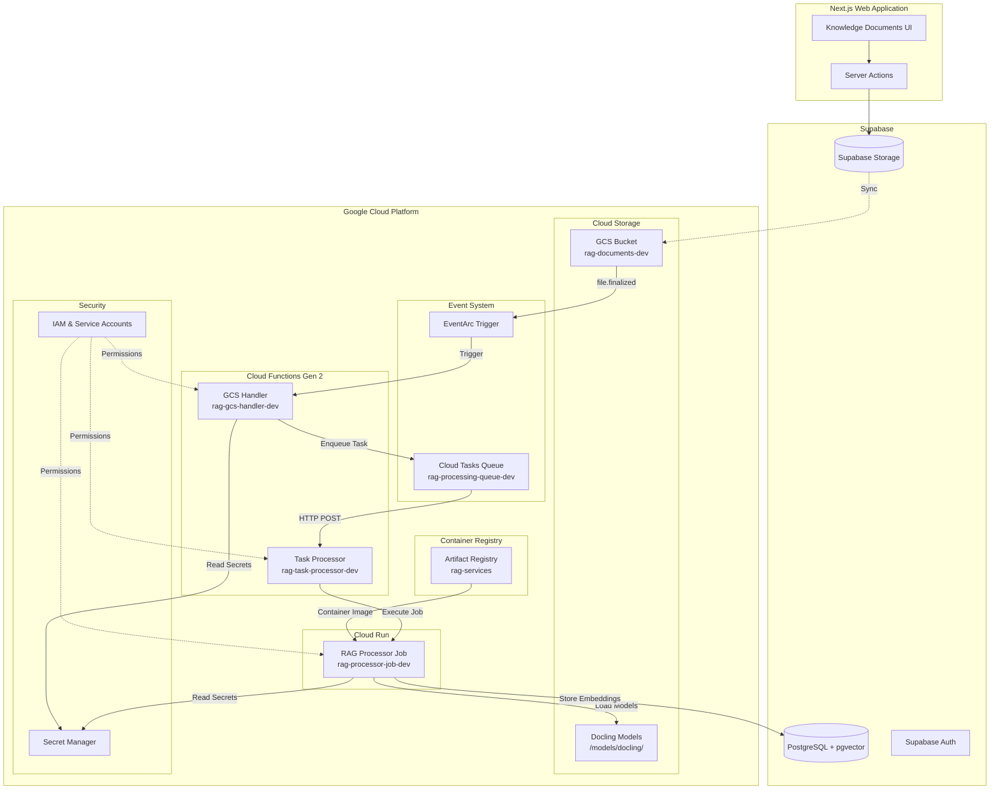
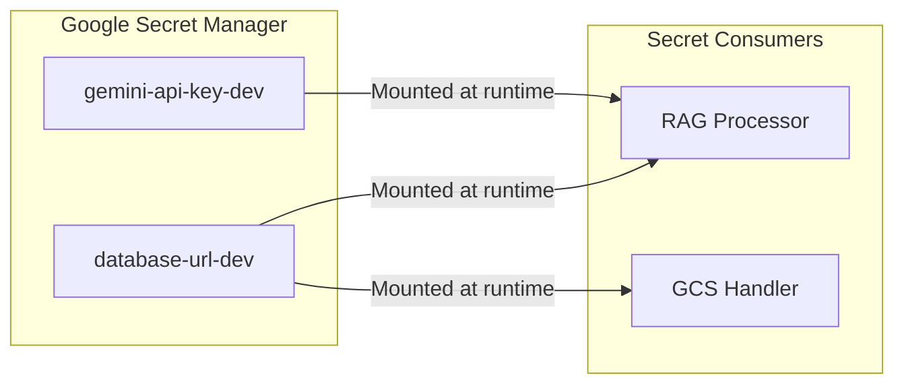
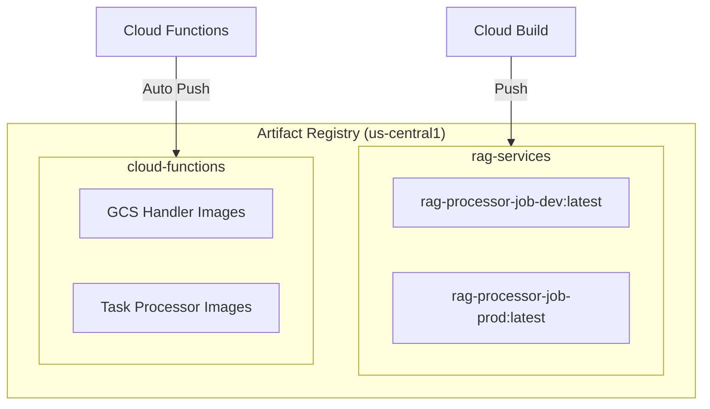
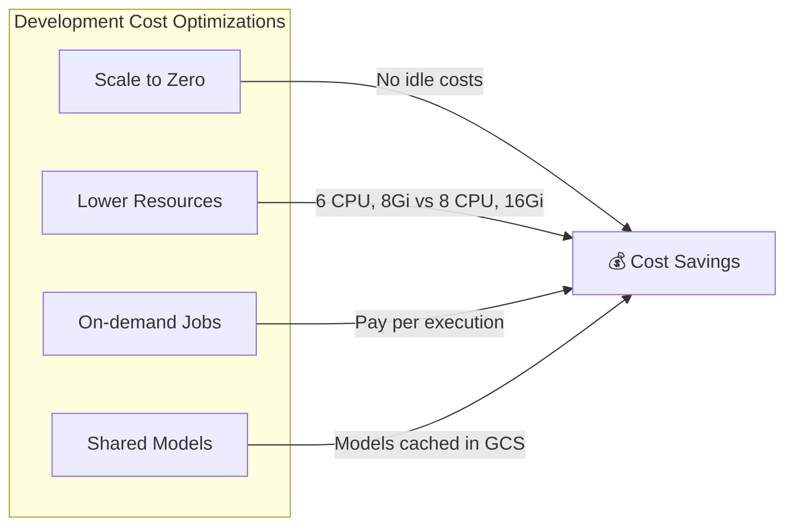

# Architecture Deep Dive

This document provides a comprehensive view of the RAG GCP pipeline architecture with detailed diagrams.

## High-Level Architecture

```
┌─────────────────────────────────────────────────────────────────────────────────┐
│                              WARRIORFORGE RAG PIPELINE                          │
├─────────────────────────────────────────────────────────────────────────────────┤
│                                                                                 │
│  ┌──────────────┐     ┌──────────────┐     ┌──────────────┐     ┌────────────┐ │
│  │   Next.js    │────▶│   Supabase   │────▶│    GCS       │────▶│  EventArc  │ │
│  │   Web App    │     │   Storage    │     │   Bucket     │     │  Trigger   │ │
│  └──────────────┘     └──────────────┘     └──────────────┘     └─────┬──────┘ │
│                                                                       │        │
│                                                                       ▼        │
│  ┌──────────────┐     ┌──────────────┐     ┌──────────────┐     ┌────────────┐ │
│  │   pgvector   │◀────│  RAG         │◀────│   Cloud      │◀────│    GCS     │ │
│  │  (Supabase)  │     │  Processor   │     │   Tasks      │     │   Handler  │ │
│  └──────────────┘     │ (Cloud Run)  │     │   Queue      │     │ (Function) │ │
│                       └──────────────┘     └──────────────┘     └────────────┘ │
│                              ▲                    │                             │
│                              │                    ▼                             │
│                       ┌──────────────┐     ┌──────────────┐                     │
│                       │   Docling    │     │    Task      │                     │
│                       │   Models     │     │  Processor   │                     │
│                       │   (GCS)      │     │ (Function)   │                     │
│                       └──────────────┘     └──────────────┘                     │
│                                                                                 │
└─────────────────────────────────────────────────────────────────────────────────┘
```

## Mermaid: Complete System Architecture



## Component Details

### 1. Service Accounts

```
┌─────────────────────────────────────────────────────────────────────────────────┐
│                           SERVICE ACCOUNTS                                       │
├─────────────────────────────────────────────────────────────────────────────────┤
│                                                                                 │
│  ┌─────────────────────────────────────────────────────────────────────────┐   │
│  │ rag-processor-dev@{project}.iam.gserviceaccount.com                     │   │
│  ├─────────────────────────────────────────────────────────────────────────┤   │
│  │ Roles:                                                                   │   │
│  │   • roles/storage.admin           (Read/write GCS bucket)               │   │
│  │   • roles/secretmanager.secretAccessor (Read secrets)                   │   │
│  │   • roles/aiplatform.user         (Use Vertex AI)                       │   │
│  │   • roles/speech.client           (Use Speech API)                      │   │
│  │   • roles/artifactregistry.writer (Push Docker images)                  │   │
│  │   • roles/run.developer           (Deploy Cloud Run Jobs)               │   │
│  │   • roles/run.invoker             (Execute Cloud Run Jobs)              │   │
│  └─────────────────────────────────────────────────────────────────────────┘   │
│                                                                                 │
│  ┌─────────────────────────────────────────────────────────────────────────┐   │
│  │ rag-gcs-handler-dev@{project}.iam.gserviceaccount.com                   │   │
│  ├─────────────────────────────────────────────────────────────────────────┤   │
│  │ Roles:                                                                   │   │
│  │   • roles/secretmanager.secretAccessor (Read secrets)                   │   │
│  │   • roles/cloudtasks.enqueuer     (Create tasks in queue)               │   │
│  │   • roles/storage.objectViewer    (Read GCS objects)                    │   │
│  │   • iam.serviceAccountTokenCreator (Create OIDC tokens)                 │   │
│  └─────────────────────────────────────────────────────────────────────────┘   │
│                                                                                 │
│  ┌─────────────────────────────────────────────────────────────────────────┐   │
│  │ rag-task-processor-dev@{project}.iam.gserviceaccount.com                │   │
│  ├─────────────────────────────────────────────────────────────────────────┤   │
│  │ Roles:                                                                   │   │
│  │   • roles/run.invoker             (Invoke Cloud Run Jobs)               │   │
│  │   • roles/run.developer           (Manage Cloud Run Jobs)               │   │
│  │   • roles/iam.serviceAccountUser  (Act as processor SA)                 │   │
│  └─────────────────────────────────────────────────────────────────────────┘   │
│                                                                                 │
└─────────────────────────────────────────────────────────────────────────────────┘
```

### 2. Secrets Architecture



### 3. Cloud Tasks Queue Configuration

```
┌─────────────────────────────────────────────────────────────────────────────────┐
│                    CLOUD TASKS QUEUE: rag-processing-queue-dev                  │
├─────────────────────────────────────────────────────────────────────────────────┤
│                                                                                 │
│  Configuration:                                                                 │
│  ├── Max Dispatches Per Second: 10                                             │
│  ├── Max Concurrent Dispatches: 5                                              │
│  ├── Max Retry Attempts: 3                                                     │
│  ├── Min Backoff: 10 seconds                                                   │
│  └── Max Backoff: 300 seconds                                                  │
│                                                                                 │
│  Task Flow:                                                                     │
│  ┌──────────┐    ┌──────────┐    ┌──────────┐    ┌──────────────┐             │
│  │ GCS      │───▶│  Queue   │───▶│  Task    │───▶│  RAG         │             │
│  │ Handler  │    │          │    │ Processor│    │  Processor   │             │
│  └──────────┘    └──────────┘    └──────────┘    └──────────────┘             │
│       │               │               │                │                       │
│   Enqueue          Buffer         Dispatch          Execute                    │
│    Task            Tasks           Task               Job                      │
│                                                                                 │
└─────────────────────────────────────────────────────────────────────────────────┘
```

### 4. Artifact Registry Structure



## Resource Naming Convention

| Resource Type | Development | Production |
|---------------|-------------|------------|
| Storage Bucket | `{project}-rag-documents-dev` | `{project}-rag-documents-prod` |
| Cloud Run Job | `rag-processor-job-dev` | `rag-processor-job-prod` |
| GCS Handler | `rag-gcs-handler-dev` | `rag-gcs-handler-prod` |
| Task Processor | `rag-task-processor-dev` | `rag-task-processor-prod` |
| Tasks Queue | `rag-processing-queue-dev` | `rag-processing-queue-prod` |
| Secrets | `database-url-dev` | `database-url-prod` |
| Service Accounts | `rag-*-dev@...` | `rag-*-prod@...` |

## GCS Bucket Structure

```
gs://{project}-rag-documents-dev/
├── documents/
│   └── {creator-id}/
│       ├── document1.pdf
│       ├── document2.docx
│       └── ...
├── models/
│   └── docling/
│       ├── layout/
│       ├── tableformer/
│       ├── picture_classifier/
│       ├── code_formula/
│       └── easyocr/
└── temp/
    └── processing/
```

## Network Architecture

```
┌─────────────────────────────────────────────────────────────────────────────────┐
│                              NETWORK FLOW                                        │
├─────────────────────────────────────────────────────────────────────────────────┤
│                                                                                 │
│  EXTERNAL                     GCP INTERNAL                      EXTERNAL        │
│  ────────                     ────────────                      ────────        │
│                                                                                 │
│  ┌────────┐                   ┌──────────────┐                  ┌──────────┐   │
│  │ Creator  │──────HTTPS───────▶│   EventArc   │                  │ Supabase │   │
│  │ (Web)  │                   │   Triggers   │                  │   DB     │   │
│  └────────┘                   └──────┬───────┘                  └────▲─────┘   │
│                                      │                               │         │
│                               VPC Internal                     Port 6543       │
│                                      │                          (Pooler)       │
│                                      ▼                               │         │
│                               ┌──────────────┐                       │         │
│                               │   Cloud      │───────────────────────┘         │
│                               │   Functions  │                                  │
│                               └──────┬───────┘                                  │
│                                      │                                          │
│                               VPC Internal                                      │
│                                      │                                          │
│                                      ▼                                          │
│                               ┌──────────────┐                                  │
│                               │  Cloud Run   │                                  │
│                               │    Jobs      │                                  │
│                               └──────────────┘                                  │
│                                                                                 │
└─────────────────────────────────────────────────────────────────────────────────┘
```

## Cost Optimization Features



## Security Model

```
┌─────────────────────────────────────────────────────────────────────────────────┐
│                              SECURITY LAYERS                                     │
├─────────────────────────────────────────────────────────────────────────────────┤
│                                                                                 │
│  Layer 1: Authentication                                                        │
│  ├── All Cloud Functions require authenticated requests                         │
│  ├── Cloud Run Jobs are private (no public access)                             │
│  └── Service accounts used for inter-service communication                      │
│                                                                                 │
│  Layer 2: Authorization (IAM)                                                   │
│  ├── Principle of least privilege                                              │
│  ├── Separate service accounts per component                                   │
│  └── Cross-service permissions explicitly granted                              │
│                                                                                 │
│  Layer 3: Secrets Management                                                    │
│  ├── All credentials stored in Secret Manager                                  │
│  ├── Secrets mounted at runtime (not in environment)                           │
│  └── Version-controlled secret updates                                         │
│                                                                                 │
│  Layer 4: Network Security                                                      │
│  ├── HTTPS only for all external traffic                                       │
│  ├── VPC-internal communication where possible                                 │
│  └── Database connection via pooler (not direct)                               │
│                                                                                 │
└─────────────────────────────────────────────────────────────────────────────────┘
```
