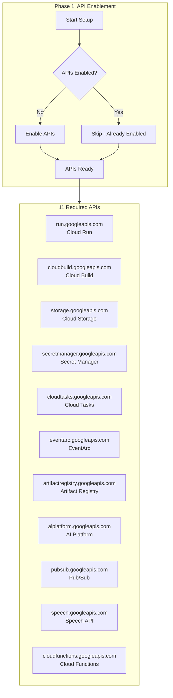
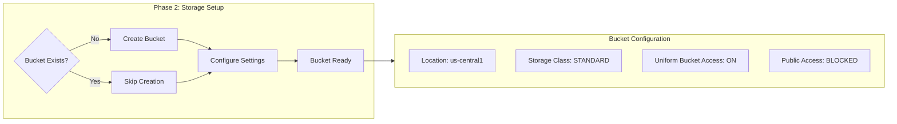
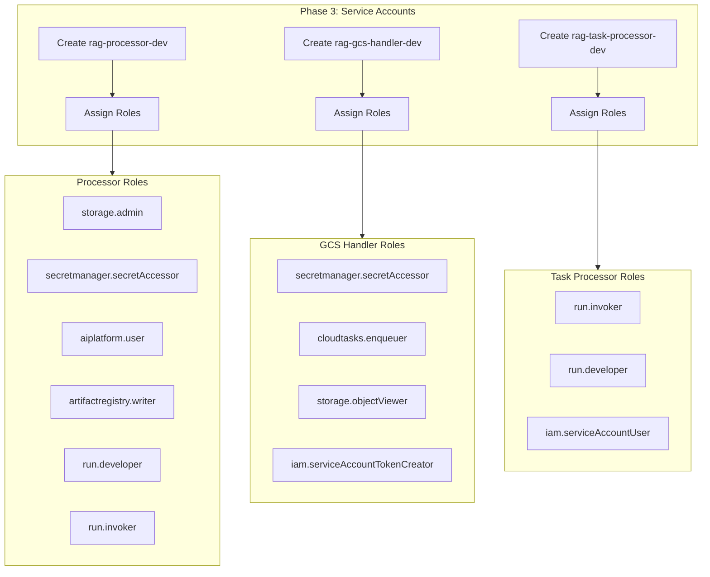
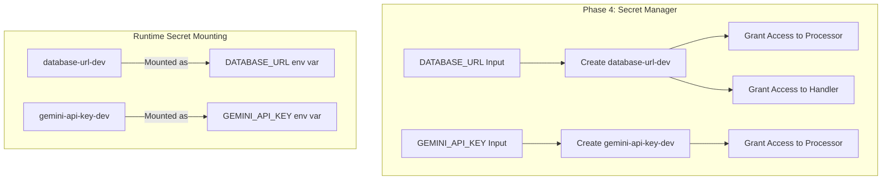
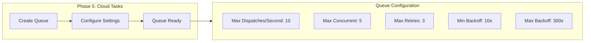
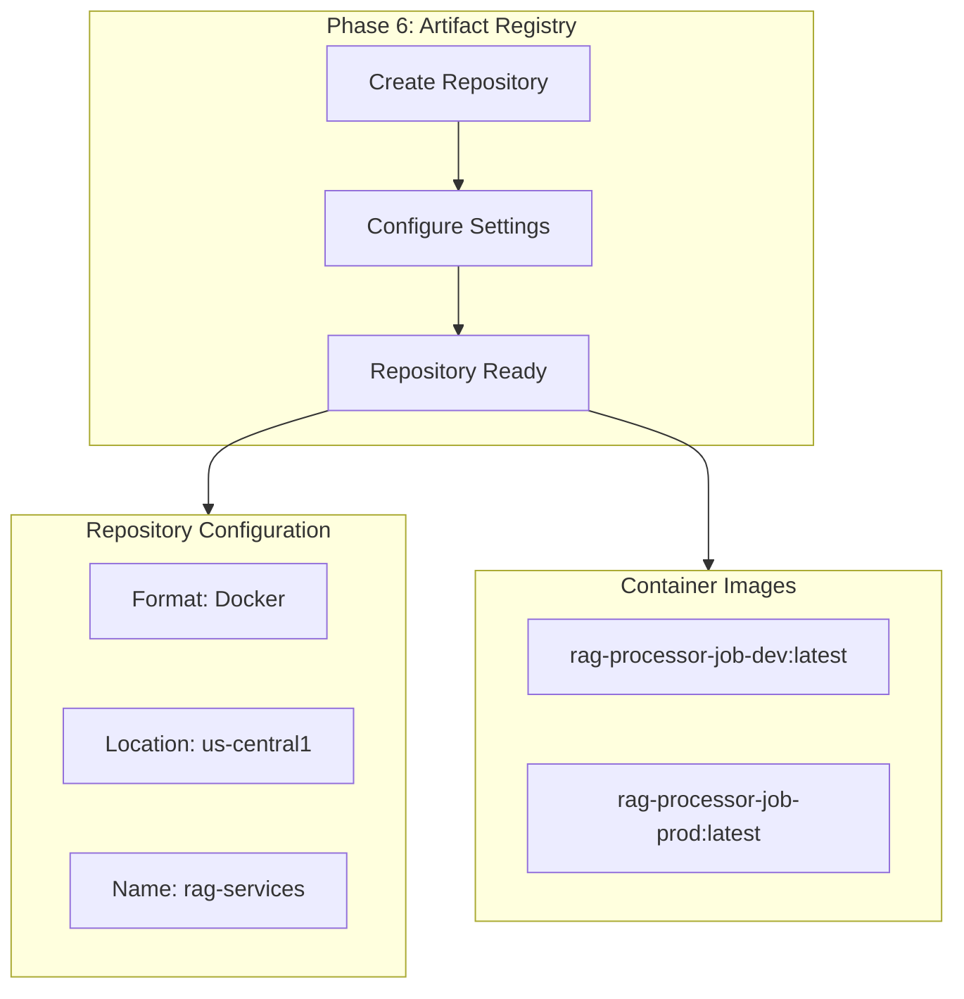
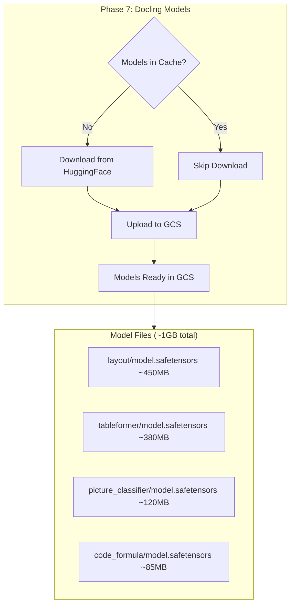

# GCP Setup Explained

This document explains what happens during each phase of `npm run setup:gcp:dev`.

## Setup Flow Overview

```
┌─────────────────────────────────────────────────────────────────────────────────┐
│                         SETUP PROCESS FLOW                                       │
├─────────────────────────────────────────────────────────────────────────────────┤
│                                                                                 │
│   Phase 1        Phase 2        Phase 3        Phase 4        Phase 5          │
│   ────────       ────────       ────────       ────────       ────────          │
│  ┌────────┐    ┌────────┐    ┌────────┐    ┌────────┐    ┌────────┐           │
│  │  API   │───▶│Storage │───▶│Service │───▶│Secrets │───▶│ Cloud  │           │
│  │Enable  │    │ Bucket │    │Accounts│    │Manager │    │ Tasks  │           │
│  └────────┘    └────────┘    └────────┘    └────────┘    └────────┘           │
│      │              │              │              │              │              │
│      ▼              ▼              ▼              ▼              ▼              │
│  11 APIs       1 Bucket       3 Service     2 Secrets     1 Queue             │
│  enabled       created        Accounts      stored        created             │
│                               + IAM roles                                       │
│                                                                                 │
│                         Phase 6                    Phase 7                      │
│                         ────────                   ────────                     │
│                       ┌────────┐                 ┌────────┐                    │
│                       │Artifact│────────────────▶│Docling │                    │
│                       │Registry│                 │ Models │                    │
│                       └────────┘                 └────────┘                    │
│                            │                          │                         │
│                            ▼                          ▼                         │
│                       1 Repository              ~1GB models                    │
│                       created                   uploaded to GCS                │
│                                                                                 │
└─────────────────────────────────────────────────────────────────────────────────┘
```

## Phase 1: Enable Google Cloud APIs



### What Happens

```
📋 Phase 1: Enable Required APIs
   Enabling: run.googleapis.com
   ✅ run.googleapis.com enabled
   Enabling: cloudbuild.googleapis.com
   ✅ cloudbuild.googleapis.com enabled
   Enabling: storage.googleapis.com
   ✅ storage.googleapis.com enabled
   ... (continues for all 11 APIs)
```

**Purpose:** Each API enables specific GCP functionality:

| API | Purpose |
|-----|---------|
| `run.googleapis.com` | Deploy and run Cloud Run Jobs |
| `cloudbuild.googleapis.com` | Build Docker images in cloud |
| `storage.googleapis.com` | Store documents and models |
| `secretmanager.googleapis.com` | Store database URLs and API keys |
| `cloudtasks.googleapis.com` | Queue processing jobs |
| `eventarc.googleapis.com` | Trigger functions on events |
| `artifactregistry.googleapis.com` | Store Docker images |
| `aiplatform.googleapis.com` | Access Vertex AI embeddings |
| `pubsub.googleapis.com` | Event messaging backbone |
| `speech.googleapis.com` | Audio transcription (future) |
| `cloudfunctions.googleapis.com` | Deploy Cloud Functions |

**Timing:** ~30-60 seconds (APIs enable in parallel)

## Phase 2: Create Storage Bucket



### What Happens

```
📦 Phase 2: Create Storage Bucket
   Creating bucket: gs://your-gcp-project-id-rag-documents-dev
   Setting uniform bucket-level access...
   Blocking public access...
   ✅ Bucket created successfully
```

**Bucket Structure Created:**

```
gs://{project-id}-rag-documents-dev/
├── documents/           # Creator uploaded documents
│   └── {creator-id}/     # Organized by creator
│       └── {program-id}/  # Then by program
├── models/             # Docling ML models (added during deployment)
│   └── docling/
└── temp/               # Temporary processing files
    └── processing/
```

**Security Settings:**
- Uniform bucket-level access (no per-object ACLs)
- Public access prevention enabled
- Only service accounts can access

## Phase 3: Create Service Accounts & IAM Roles



### What Happens

```
🔐 Phase 3: Create Service Accounts
   Creating service account: rag-processor-dev
   ✅ Created rag-processor-dev@{project}.iam.gserviceaccount.com

   Assigning roles to rag-processor-dev:
   ✅ roles/storage.admin
   ✅ roles/secretmanager.secretAccessor
   ✅ roles/aiplatform.user
   ✅ roles/artifactregistry.writer
   ✅ roles/run.developer
   ✅ roles/run.invoker

   Creating service account: rag-gcs-handler-dev
   ... (continues for all accounts)
```

**Service Account Purposes:**

| Service Account | Purpose | Key Permissions |
|-----------------|---------|-----------------|
| `rag-processor-dev` | Runs the RAG processor job | Read/write storage, access secrets, use AI |
| `rag-gcs-handler-dev` | Handles GCS upload events | Read storage, create tasks, access secrets |
| `rag-task-processor-dev` | Processes queued tasks | Invoke Cloud Run jobs |

**Cross-Service Permissions:**

```
┌─────────────────────────────────────────────────────────────────────────────────┐
│                    INTER-SERVICE PERMISSION CHAIN                               │
├─────────────────────────────────────────────────────────────────────────────────┤
│                                                                                 │
│   GCS Handler                Task Processor              RAG Processor          │
│   ───────────               ──────────────              ─────────────           │
│                                                                                 │
│   ┌─────────┐     creates    ┌─────────┐    invokes    ┌─────────┐            │
│   │  GCS    │───────────────▶│  Task   │──────────────▶│   Job   │            │
│   │ Handler │    task        │Processor│               │Execution│            │
│   └─────────┘                └─────────┘               └─────────┘            │
│       │                           │                         │                  │
│       │ needs:                    │ needs:                  │ needs:           │
│       │ • cloudtasks.enqueuer    │ • run.invoker           │ • storage.admin  │
│       │ • tokenCreator           │ • run.developer         │ • aiplatform     │
│       │                          │ • serviceAccountUser    │ • secrets        │
│                                                                                 │
└─────────────────────────────────────────────────────────────────────────────────┘
```

## Phase 4: Configure Secrets



### What Happens

```
🔑 Phase 4: Configure Secrets
   Creating secret: database-url-dev
   ✅ Secret created
   Adding secret version...
   ✅ Secret value stored

   Granting access to rag-processor-dev...
   ✅ Access granted
   Granting access to rag-gcs-handler-dev...
   ✅ Access granted

   Creating secret: gemini-api-key-dev (optional)
   ... (if API key provided)
```

**Secret Security:**
- Secrets stored encrypted at rest
- Accessed only by authorized service accounts
- Mounted at runtime (not baked into images)
- Version-controlled for safe updates

**Database URL Format:**
```
postgresql://postgres.{ref}:{password}@{region}.pooler.supabase.com:6543/postgres
                                                                    ^^^^
                                                              MUST be pooled port
```

## Phase 5: Create Cloud Tasks Queue



### What Happens

```
📋 Phase 5: Create Cloud Tasks Queue
   Creating queue: rag-processing-queue-dev
   Location: us-central1

   Configuring queue settings:
   • Max dispatches per second: 10
   • Max concurrent dispatches: 5
   • Max retry attempts: 3
   • Min backoff: 10 seconds
   • Max backoff: 300 seconds

   ✅ Queue created successfully
```

**Queue Behavior:**

```
┌─────────────────────────────────────────────────────────────────────────────────┐
│                         TASK LIFECYCLE                                          │
├─────────────────────────────────────────────────────────────────────────────────┤
│                                                                                 │
│   Task Created ──▶ Queued ──▶ Dispatched ──▶ Processing ──▶ Complete           │
│                       │            │              │                             │
│                       │            │              ▼                             │
│                       │            │          Failure?                          │
│                       │            │              │                             │
│                       │            │         ┌────┴────┐                        │
│                       │            │         │  Yes    │                        │
│                       │            │         ▼         │                        │
│                       │            │    Retry < 3?     │                        │
│                       │            │         │         │                        │
│                       │            │    ┌────┴────┐    │                        │
│                       │            │    │  Yes    │    │ No                     │
│                       │            │    ▼         │    ▼                        │
│                       │◀───────────┴──Backoff    Dead Letter                   │
│                       │              (10-300s)                                  │
│                                                                                 │
└─────────────────────────────────────────────────────────────────────────────────┘
```

## Phase 6: Create Artifact Registry



### What Happens

```
🐳 Phase 6: Create Artifact Registry
   Creating repository: rag-services
   Format: Docker
   Location: us-central1

   ✅ Repository created successfully

   Repository URL:
   us-central1-docker.pkg.dev/{project}/rag-services/
```

**Registry Purpose:**
- Stores Docker images for Cloud Run Jobs
- Provides versioning and tagging
- Enables fast deployment from pre-built images
- Scans images for vulnerabilities

## Phase 7: Download and Upload Docling Models



### What Happens

```
🤖 Phase 7: Download Docling Models
   Checking local cache: ~/.cache/docling/models/
   Downloading models from HuggingFace...
   ✅ layout model downloaded
   ✅ tableformer model downloaded
   ✅ picture_classifier model downloaded
   ✅ code_formula model downloaded

   Uploading to GCS: gs://{project}-rag-documents-dev/models/docling/
   ✅ Models uploaded successfully
```

**Purpose:**
- Docling ML models are required for PDF document processing
- Models are downloaded once and cached locally at `~/.cache/docling/models/`
- Models are uploaded to GCS so Docker builds can pull them during deployment
- This avoids baking ~1GB of models directly into Docker images

**Timing:**
- **First run:** 10-15 minutes (downloading ~1GB from HuggingFace)
- **Subsequent runs:** 1-2 minutes (uses local cache, only uploads to GCS)

**GCS Structure After Upload:**

```
gs://{project-id}-rag-documents-dev/
└── models/
    └── docling/
        ├── layout/
        │   ├── config.json
        │   └── model.safetensors
        ├── tableformer/
        │   ├── config.json
        │   └── model.safetensors
        ├── picture_classifier/
        │   ├── config.json
        │   └── model.safetensors
        └── code_formula/
            ├── config.json
            └── model.safetensors
```

**Why This Matters:**
- Deployment will **FAIL** without models in GCS
- Docker build's model-downloader stage pulls from GCS, not HuggingFace
- Error if missing: `Missing safe tensors file: /app/models/docling/model.safetensors`

## Complete Setup Summary

```
┌─────────────────────────────────────────────────────────────────────────────────┐
│                         SETUP COMPLETION                                         │
├─────────────────────────────────────────────────────────────────────────────────┤
│                                                                                 │
│   ✅ 11 APIs enabled                                                            │
│   ✅ 1 Storage bucket created                                                   │
│   ✅ 3 Service accounts with IAM roles                                          │
│   ✅ 2 Secrets stored (DATABASE_URL, optional GEMINI_API_KEY)                   │
│   ✅ 1 Cloud Tasks queue configured                                             │
│   ✅ 1 Artifact Registry repository                                             │
│   ✅ Docling ML models uploaded to GCS (~1GB)                                   │
│                                                                                 │
│   📋 Infrastructure Summary:                                                     │
│     • Environment: Development                                                   │
│     • Project: your-gcp-project-id                                       │
│     • Region: us-central1                                                        │
│     • Storage: gs://your-gcp-project-id-rag-documents-dev                │
│     • Models: gs://your-gcp-project-id-rag-documents-dev/models/docling/ │
│                                                                                 │
│   🚀 Ready for deployment!                                                       │
│                                                                                 │
└─────────────────────────────────────────────────────────────────────────────────┘
```

## Idempotency

The setup script is **idempotent** - safe to run multiple times:

| Resource | On Re-run |
|----------|-----------|
| APIs | Skipped if already enabled |
| Bucket | Skipped if exists |
| Service Accounts | Updated with latest roles |
| Secrets | New version added (preserves history) |
| Queue | Configuration updated |
| Registry | Skipped if exists |

## Next Step

After setup completes, proceed to [Deployment](./03-deployment.md).
