# Deployment Process Explained

This document explains what happens during each deployment command.

## Deployment Overview

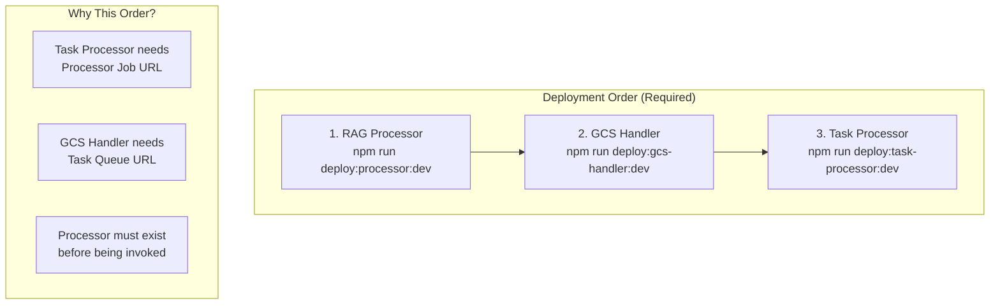

## 1. RAG Processor Deployment

```bash
npm run deploy:processor:dev
```

### Deployment Flow

```
┌─────────────────────────────────────────────────────────────────────────────────┐
│                    RAG PROCESSOR DEPLOYMENT                                      │
├─────────────────────────────────────────────────────────────────────────────────┤
│                                                                                 │
│   Phase 1              Phase 2              Phase 3              Phase 4        │
│   ────────             ────────             ────────             ────────        │
│  ┌────────┐          ┌────────┐          ┌────────┐          ┌────────┐        │
│  │Download│─────────▶│ Build  │─────────▶│  Push  │─────────▶│ Deploy │        │
│  │ Models │          │ Docker │          │ Image  │          │  Job   │        │
│  └────────┘          └────────┘          └────────┘          └────────┘        │
│      │                   │                   │                   │              │
│   ~5 min              ~3 min               ~2 min              ~1 min           │
│   (first)             (first)                                                   │
│                                                                                 │
└─────────────────────────────────────────────────────────────────────────────────┘
```

### Phase 1: Download Docling Models

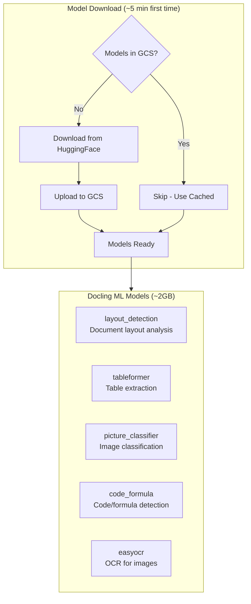

**What Happens:**

```
📦 Phase 1: Model Setup
   Checking for existing models in GCS...

   Downloading Docling models from HuggingFace:
   ⬇️ layout/model.safetensors (450MB)
   ⬇️ tableformer/model.safetensors (380MB)
   ⬇️ picture_classifier/model.safetensors (120MB)
   ⬇️ code_formula/model.safetensors (85MB)
   ⬇️ easyocr/craft_mlt_25k.pth (90MB)

   Uploading to GCS: gs://project-rag-documents-dev/models/docling/
   ✅ Models ready
```

**GCS Model Structure:**

```
gs://{project}-rag-documents-dev/models/docling/
├── layout/
│   ├── config.json
│   └── model.safetensors
├── tableformer/
│   ├── config.json
│   └── model.safetensors
├── picture_classifier/
│   ├── config.json
│   └── model.safetensors
├── code_formula/
│   ├── config.json
│   └── model.safetensors
└── easyocr/
    ├── craft_mlt_25k.pth
    └── latin_g2.pth
```

### Phase 2: Docker Build

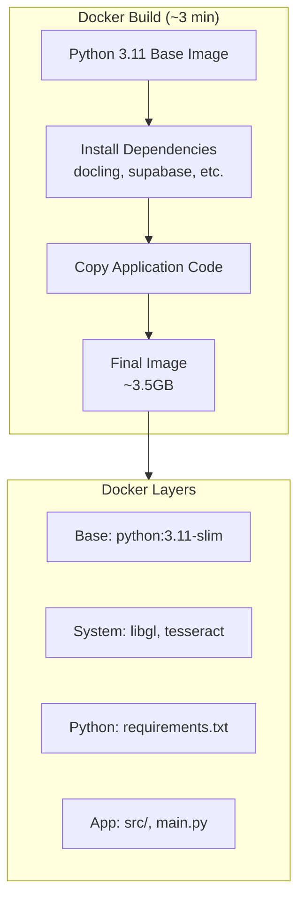

**What Happens:**

```
🐳 Phase 2: Docker Build
   Building image: us-central1-docker.pkg.dev/your-gcp-project-id/rag-services/rag-processor-job-dev

   Step 1/12: FROM python:3.11-slim
   Step 2/12: RUN apt-get update && apt-get install -y libgl1-mesa-glx...
   Step 3/12: COPY requirements.txt .
   Step 4/12: RUN pip install -r requirements.txt
   ...
   Step 12/12: CMD ["python", "main.py"]

   ✅ Image built successfully
   Size: 3.47GB
```

**Dockerfile Highlights:**

```dockerfile
FROM python:3.11-slim

# System dependencies for document processing
RUN apt-get install -y \
    libgl1-mesa-glx \    # OpenCV
    tesseract-ocr \      # OCR
    poppler-utils \      # PDF processing
    libmagic1            # File type detection

# Python dependencies
COPY requirements.txt .
RUN pip install --no-cache-dir -r requirements.txt

# Application code
COPY src/ src/
COPY main.py .

CMD ["python", "main.py"]
```

### Phase 3: Push to Artifact Registry

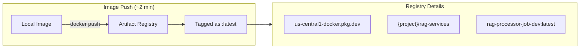

**What Happens:**

```
📤 Phase 3: Push Image
   Authenticating with Artifact Registry...
   ✅ Authenticated

   Pushing: us-central1-docker.pkg.dev/your-gcp-project-id/rag-services/rag-processor-job-dev:latest
   ⬆️ Layer 1/8: 125MB
   ⬆️ Layer 2/8: 450MB
   ⬆️ Layer 3/8: 1.2GB
   ...
   ✅ Image pushed successfully
```

### Phase 4: Deploy Cloud Run Job

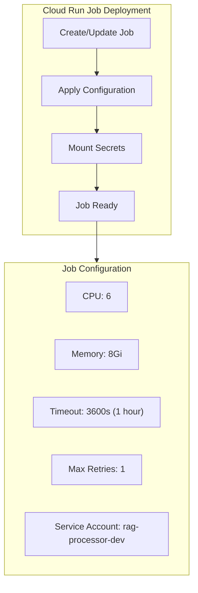

**What Happens:**

```
☁️ Phase 4: Deploy Cloud Run Job
   Creating Cloud Run Job: rag-processor-job-dev
   Region: us-central1

   Configuration:
   • CPU: 6
   • Memory: 8Gi
   • Timeout: 3600 seconds
   • Max retries: 1
   • Service account: rag-processor-dev@...

   Mounting secrets:
   • DATABASE_URL from database-url-dev:latest
   • GEMINI_API_KEY from gemini-api-key-dev:latest

   ✅ Cloud Run Job deployed successfully

   Job URL: https://us-central1-run.googleapis.com/apis/run.googleapis.com/v1/namespaces/your-gcp-project-id/jobs/rag-processor-job-dev
```

**Cloud Run Job vs Service:**

| Aspect | Cloud Run Job | Cloud Run Service |
|--------|---------------|-------------------|
| Invocation | On-demand execution | Always-on HTTP endpoint |
| Billing | Pay per execution | Pay while running |
| Timeout | Up to 24 hours | 60 minutes max |
| Use Case | Batch processing | Web APIs |

---

## 2. GCS Handler Deployment

```bash
npm run deploy:gcs-handler:dev
```

### Deployment Flow

```
┌─────────────────────────────────────────────────────────────────────────────────┐
│                    GCS HANDLER DEPLOYMENT                                        │
├─────────────────────────────────────────────────────────────────────────────────┤
│                                                                                 │
│   Phase 1              Phase 2              Phase 3                             │
│   ────────             ────────             ────────                             │
│  ┌────────┐          ┌────────┐          ┌────────┐                            │
│  │Package │─────────▶│ Deploy │─────────▶│Configure│                           │
│  │  Code  │          │Function│          │EventArc │                           │
│  └────────┘          └────────┘          └────────┘                            │
│      │                   │                   │                                  │
│   ~30 sec             ~2 min              ~30 sec                               │
│                                                                                 │
└─────────────────────────────────────────────────────────────────────────────────┘
```

### Phase 1: Package Code

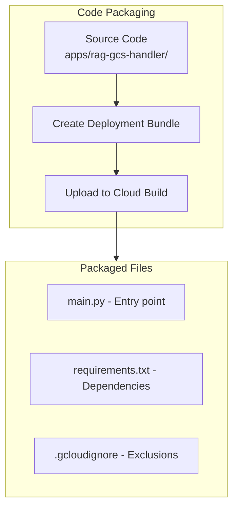

### Phase 2: Deploy Cloud Function

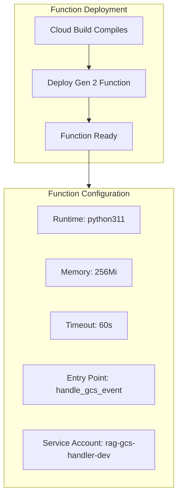

**What Happens:**

```
🚀 GCS Handler Deployment
=======================================

📋 Deploying Cloud Function: rag-gcs-handler-dev
   Runtime: python311
   Entry point: handle_gcs_event
   Memory: 256Mi
   Timeout: 60s

   Building function...
   ⏳ Build in progress...
   ✅ Build complete

   Deploying function...
   ✅ Function deployed
```

### Phase 3: Configure EventArc Trigger

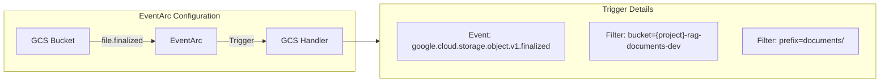

**What Happens:**

```
📡 Configuring EventArc Trigger
   Event type: google.cloud.storage.object.v1.finalized
   Bucket: your-gcp-project-id-rag-documents-dev
   Path filter: documents/*

   ✅ EventArc trigger configured
```

**Trigger Logic:**

```python
# Only triggers for files matching:
# gs://{bucket}/documents/{creator-id}/{program-id}/{filename}

def handle_gcs_event(cloud_event):
    data = cloud_event.data
    bucket = data["bucket"]
    name = data["name"]  # e.g., "documents/creator-123/program-456/file.pdf"

    # Validate path structure
    if not name.startswith("documents/"):
        return  # Ignore non-document uploads

    # Extract creator_id and program_id from path
    parts = name.split("/")
    if len(parts) < 4:  # Validate 3-level structure
        return
    creator_id = parts[1]
    program_id = parts[2]
    filename = parts[3]

    # Create task for processing
    create_cloud_task(bucket, name, creator_id, program_id)
```

---

## 3. Task Processor Deployment

```bash
npm run deploy:task-processor:dev
```

### Deployment Flow

```
┌─────────────────────────────────────────────────────────────────────────────────┐
│                    TASK PROCESSOR DEPLOYMENT                                     │
├─────────────────────────────────────────────────────────────────────────────────┤
│                                                                                 │
│   Phase 1              Phase 2              Phase 3                             │
│   ────────             ────────             ────────                             │
│  ┌────────┐          ┌────────┐          ┌────────┐                            │
│  │Package │─────────▶│ Deploy │─────────▶│Configure│                           │
│  │  Code  │          │Function│          │ as Task │                           │
│  └────────┘          └────────┘          │ Target  │                           │
│      │                   │               └────────┘                            │
│   ~30 sec             ~2 min              ~30 sec                               │
│                                                                                 │
└─────────────────────────────────────────────────────────────────────────────────┘
```

### Phase 2: Deploy Cloud Function

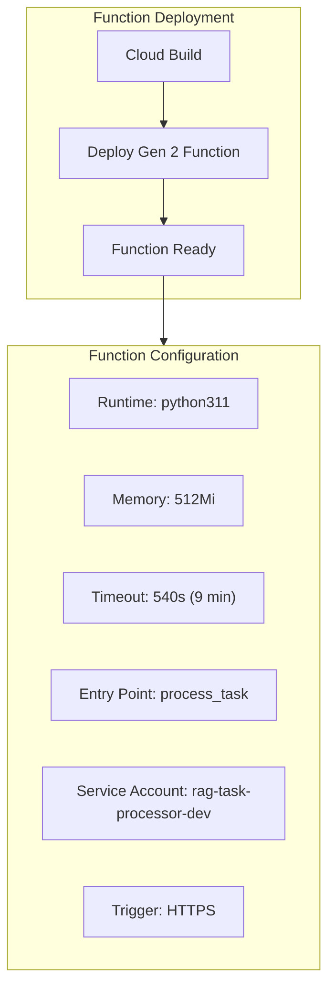

**What Happens:**

```
🚀 Task Processor Deployment
==========================================

📋 Deploying Cloud Function: rag-task-processor-dev
   Runtime: python311
   Entry point: process_task
   Memory: 512Mi
   Timeout: 540s

   Building function...
   ⏳ Build in progress...
   ✅ Build complete

   Deploying function...
   ✅ Function deployed

   Function URL: https://us-central1-your-gcp-project-id.cloudfunctions.net/rag-task-processor-dev
```

### Phase 3: Configure as Task Target

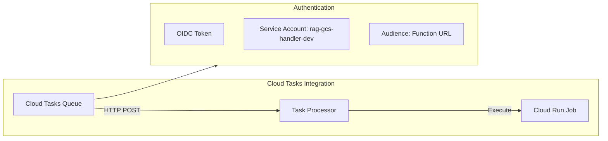

**Task Processor Logic:**

```python
def process_task(request):
    """Receives task from Cloud Tasks, invokes RAG Processor Job."""

    # Parse task payload
    task_data = request.get_json()
    bucket = task_data["bucket"]
    object_name = task_data["object_name"]
    creator_id = task_data["creator_id"]
    program_id = task_data["program_id"]

    # Execute Cloud Run Job
    job_name = "rag-processor-job-dev"
    execution = run_job(
        job_name=job_name,
        env_vars={
            "GCS_BUCKET": bucket,
            "GCS_OBJECT": object_name,
            "CREATOR_ID": creator_id,
            "PROGRAM_ID": program_id,
        }
    )

    return {"execution_id": execution.name}
```

---

## Complete Deployment Architecture

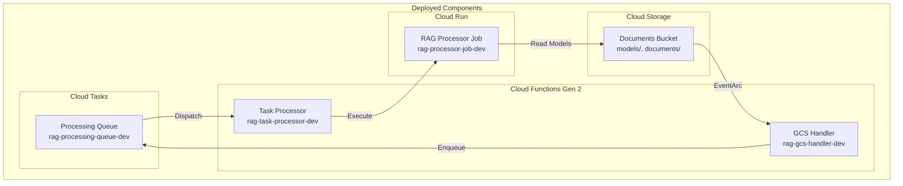

## Deployment Verification Commands

After all deployments complete:

```bash
# Verify Cloud Run Job
gcloud run jobs list --region=us-central1

# Verify Cloud Functions
gcloud functions list --v2 --regions=us-central1

# Verify EventArc Trigger
gcloud eventarc triggers list --location=us-central1

# Verify Cloud Tasks Queue
gcloud tasks queues describe rag-processing-queue-dev --location=us-central1
```

## Next Step

Proceed to [Testing](./04-testing.md) to verify the pipeline works end-to-end.
