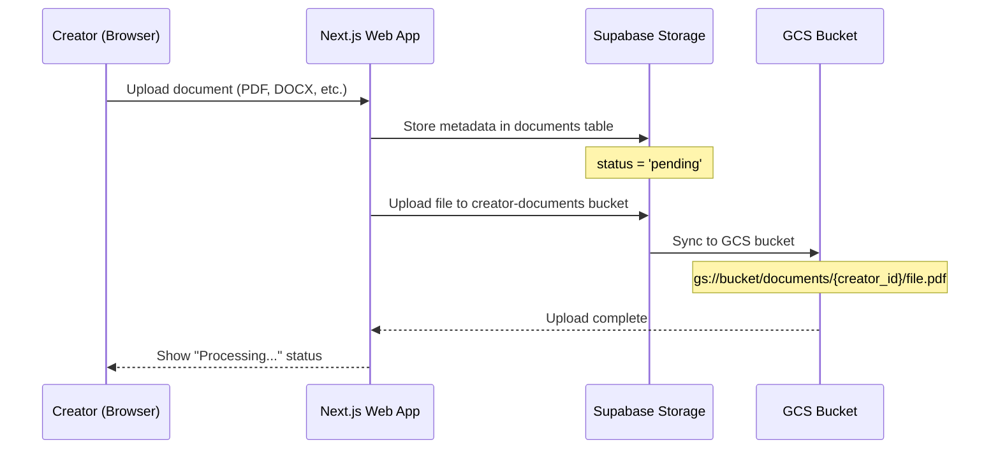
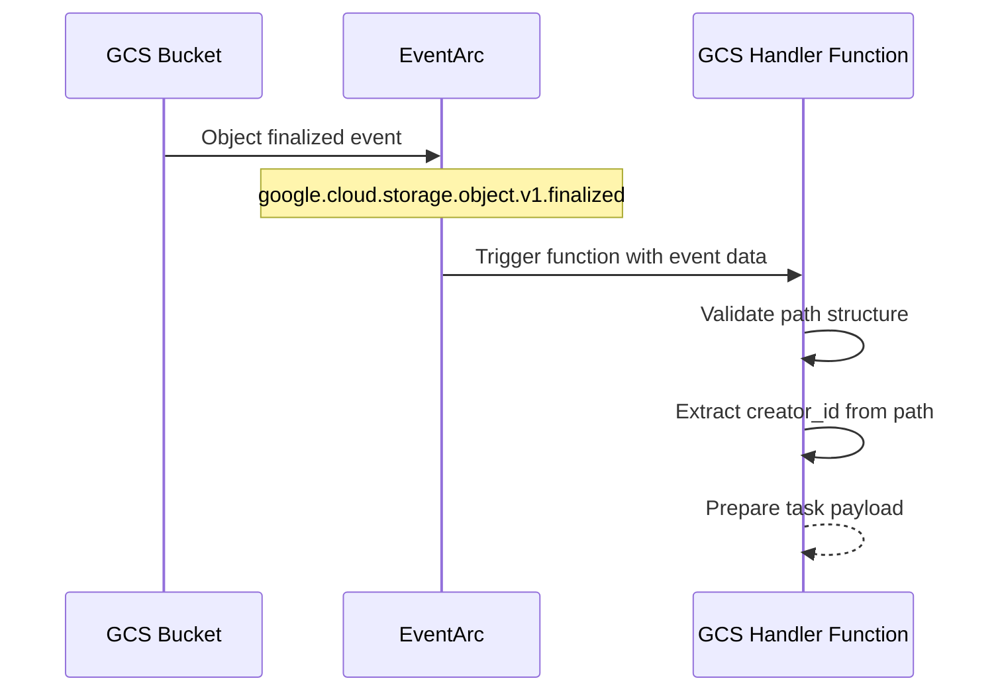
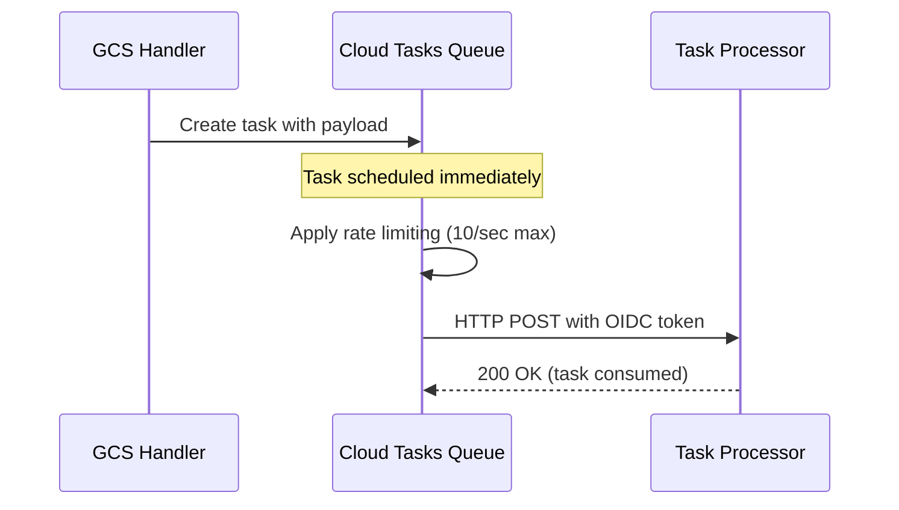
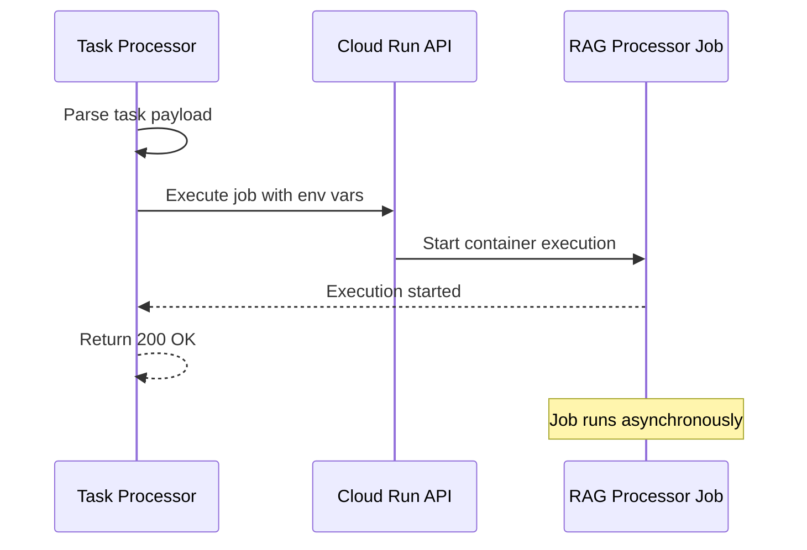
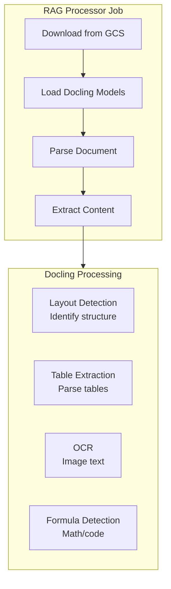
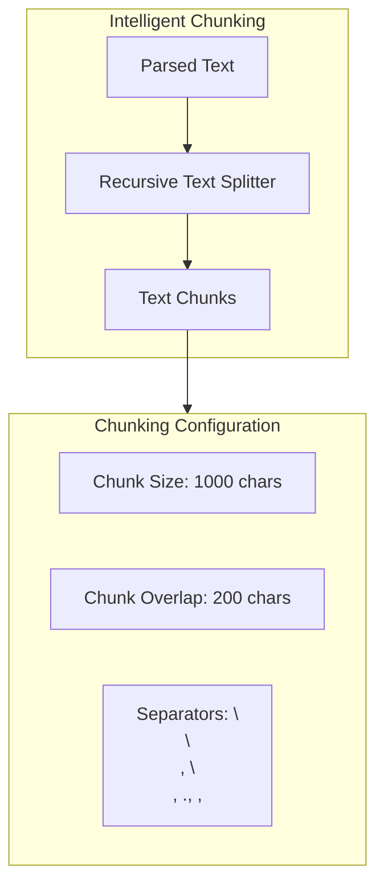
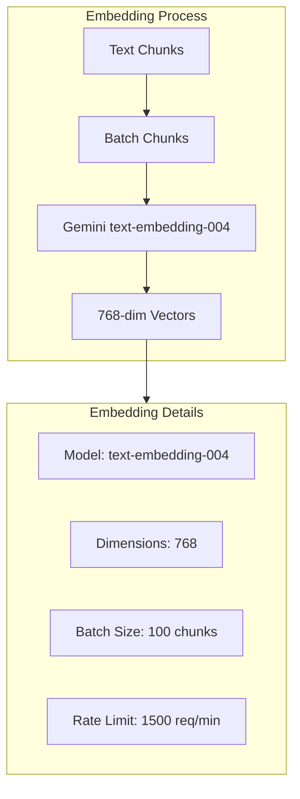
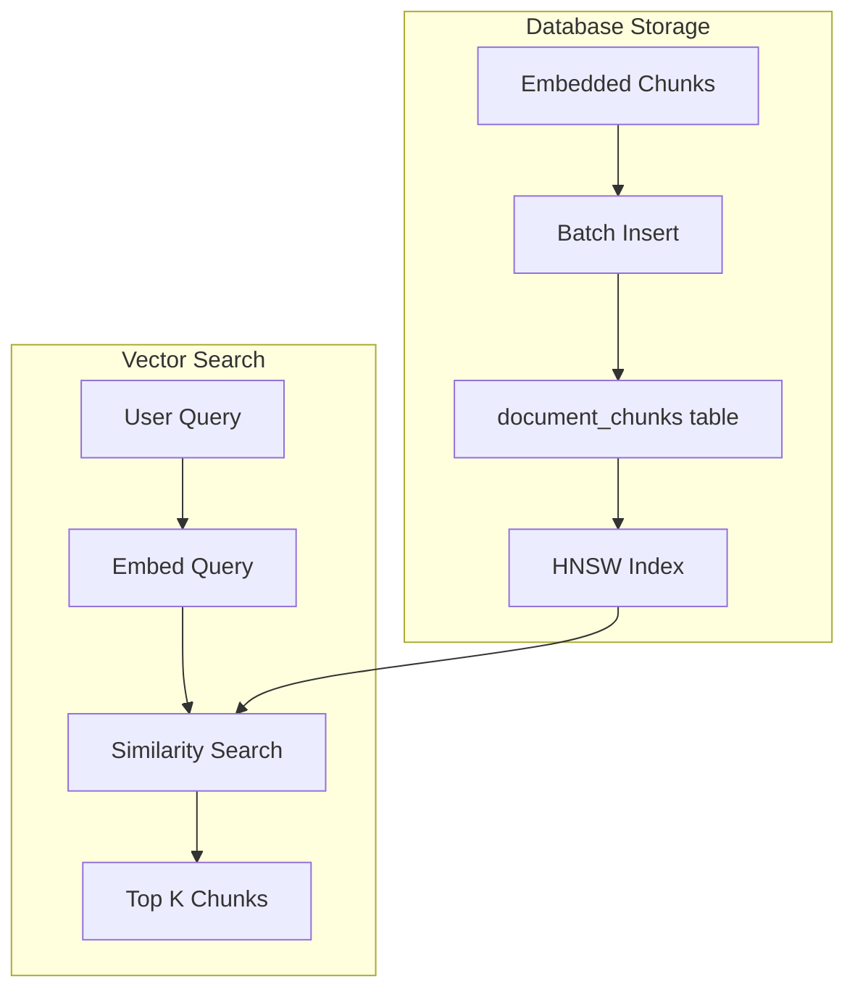
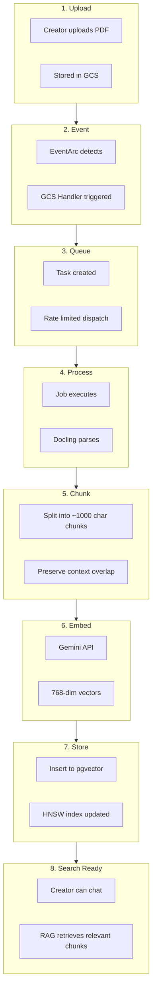

# Data Flow: Document to Embeddings

This document explains how data flows through the RAG pipeline from upload to searchable embeddings.

## Complete Data Journey

```
┌─────────────────────────────────────────────────────────────────────────────────┐
│                         DOCUMENT PROCESSING JOURNEY                             │
├─────────────────────────────────────────────────────────────────────────────────┤
│                                                                                 │
│   1. UPLOAD        2. DETECT        3. QUEUE         4. PROCESS                │
│   ────────         ────────         ────────         ────────                   │
│  ┌────────┐      ┌────────┐      ┌────────┐      ┌────────┐                   │
│  │ Creator  │─────▶│  GCS   │─────▶│ Cloud  │─────▶│  RAG   │                   │
│  │Uploads │      │Handler │      │ Tasks  │      │Processor│                   │
│  │  PDF   │      │        │      │        │      │        │                    │
│  └────────┘      └────────┘      └────────┘      └────────┘                   │
│      │               │               │               │                         │
│      ▼               ▼               ▼               ▼                         │
│  File in         Event           Task in       Job Execution                   │
│  GCS Bucket      Triggered       Queue         Started                         │
│                                                                                 │
│   5. PARSE         6. CHUNK        7. EMBED        8. STORE                    │
│   ────────         ────────        ────────        ────────                    │
│  ┌────────┐      ┌────────┐      ┌────────┐      ┌────────┐                   │
│  │Docling │─────▶│ Split  │─────▶│ Gemini │─────▶│Supabase│                   │
│  │ Parse  │      │ into   │      │Embedding│     │pgvector│                   │
│  │  Doc   │      │ Chunks │      │  API   │      │        │                    │
│  └────────┘      └────────┘      └────────┘      └────────┘                   │
│      │               │               │               │                         │
│      ▼               ▼               ▼               ▼                         │
│  Structured      Text           768-dim         Searchable                     │
│  Content         Chunks         Vectors         Embeddings                     │
│                                                                                 │
└─────────────────────────────────────────────────────────────────────────────────┘
```

## Stage 1: Document Upload



### Data at This Stage

**Supabase `documents` table:**
```sql
INSERT INTO documents (
    id,
    human_creator_id,
    program_id,
    file_name,
    file_path,
    file_type,
    file_size,
    processing_status,
    created_at
) VALUES (
    'doc-uuid-123',
    'creator-uuid-456',
    'program-uuid-789',
    'training-guide.pdf',
    'documents/creator-uuid-456/program-uuid-789/training-guide.pdf',
    'application/pdf',
    2456789,
    'pending',
    NOW()
);
```

**GCS Object:**
```
Bucket: gs://your-gcp-project-id-rag-documents-dev
Path: documents/creator-uuid-456/program-uuid-789/training-guide.pdf
Size: 2.4MB
Content-Type: application/pdf
```

---

## Stage 2: Event Detection (GCS Handler)



### Event Data Received

```python
# CloudEvent received by handler
cloud_event = {
    "type": "google.cloud.storage.object.v1.finalized",
    "source": "//storage.googleapis.com/projects/_/buckets/...",
    "data": {
        "bucket": "your-gcp-project-id-rag-documents-dev",
        "name": "documents/creator-uuid-456/program-uuid-789/training-guide.pdf",
        "contentType": "application/pdf",
        "size": "2456789",
        "timeCreated": "2024-01-15T10:30:00.000Z",
        "metageneration": "1"
    }
}
```

### Handler Processing Logic

```python
def handle_gcs_event(cloud_event):
    data = cloud_event.data
    bucket = data["bucket"]
    object_name = data["name"]

    # Validate it's a document (not a model file)
    if not object_name.startswith("documents/"):
        print(f"Ignoring non-document upload: {object_name}")
        return

    # Extract creator_id and program_id from path: documents/{creator_id}/{program_id}/filename
    path_parts = object_name.split("/")
    if len(path_parts) < 4:
        print(f"Invalid path structure: {object_name}")
        return

    creator_id = path_parts[1]
    program_id = path_parts[2]
    filename = path_parts[3]

    # Create task payload
    task_payload = {
        "bucket": bucket,
        "object_name": object_name,
        "creator_id": creator_id,
        "program_id": program_id,
        "filename": filename
    }

    # Enqueue task
    create_cloud_task(task_payload)
```

---

## Stage 3: Task Queuing



### Task Creation

```python
from google.cloud import tasks_v2

def create_cloud_task(payload):
    client = tasks_v2.CloudTasksClient()

    project = "your-gcp-project-id"
    location = "us-central1"
    queue = "rag-processing-queue-dev"
    task_processor_url = "https://us-central1-your-gcp-project-id.cloudfunctions.net/rag-task-processor-dev"

    parent = client.queue_path(project, location, queue)

    task = {
        "http_request": {
            "http_method": tasks_v2.HttpMethod.POST,
            "url": task_processor_url,
            "headers": {"Content-Type": "application/json"},
            "body": json.dumps(payload).encode(),
            "oidc_token": {
                "service_account_email": f"rag-gcs-handler-dev@{project}.iam.gserviceaccount.com",
                "audience": task_processor_url
            }
        }
    }

    response = client.create_task(parent=parent, task=task)
    return response.name
```

### Queue Configuration

```
┌─────────────────────────────────────────────────────────────────────────────────┐
│                         CLOUD TASKS QUEUE BEHAVIOR                              │
├─────────────────────────────────────────────────────────────────────────────────┤
│                                                                                 │
│   Max Dispatches/Second: 10                                                     │
│   Max Concurrent: 5                                                             │
│                                                                                 │
│   If 20 documents uploaded simultaneously:                                      │
│                                                                                 │
│   Time 0s:   [Task 1] [Task 2] [Task 3] [Task 4] [Task 5] processing           │
│              [Task 6-20] queued                                                │
│                                                                                 │
│   Time 60s:  [Task 1] complete                                                 │
│              [Task 6] starts                                                    │
│              [Task 2-5] still processing                                       │
│                                                                                 │
│   This prevents overwhelming the RAG processor with too many concurrent jobs.  │
│                                                                                 │
└─────────────────────────────────────────────────────────────────────────────────┘
```

---

## Stage 4: Job Execution (Task Processor)



### Task Processor Logic

```python
from google.cloud import run_v2

def process_task(request):
    """Receive task, execute Cloud Run Job."""

    payload = request.get_json()

    # Set up job execution
    client = run_v2.JobsClient()
    job_name = f"projects/your-gcp-project-id/locations/us-central1/jobs/rag-processor-job-dev"

    # Override environment variables for this execution
    overrides = run_v2.RunJobRequest.Overrides(
        container_overrides=[
            run_v2.RunJobRequest.Overrides.ContainerOverride(
                env=[
                    run_v2.EnvVar(name="GCS_BUCKET", value=payload["bucket"]),
                    run_v2.EnvVar(name="GCS_OBJECT", value=payload["object_name"]),
                    run_v2.EnvVar(name="CREATOR_ID", value=payload["creator_id"]),
                ]
            )
        ]
    )

    # Execute job
    operation = client.run_job(
        request=run_v2.RunJobRequest(
            name=job_name,
            overrides=overrides
        )
    )

    return {"execution": operation.metadata.name}, 200
```

---

## Stage 5: Document Parsing (Docling)



### Docling Processing

```python
from docling.document_converter import DocumentConverter
from google.cloud import storage

def process_document(bucket_name, object_name, creator_id):
    # Download document from GCS
    storage_client = storage.Client()
    bucket = storage_client.bucket(bucket_name)
    blob = bucket.blob(object_name)

    local_path = f"/tmp/{object_name.split('/')[-1]}"
    blob.download_to_filename(local_path)

    # Initialize Docling with models from GCS
    converter = DocumentConverter(
        artifacts_path="gs://your-gcp-project-id-rag-documents-dev/models/docling/"
    )

    # Parse document
    result = converter.convert(local_path)

    # Extract structured content
    document = result.document

    return {
        "text": document.export_to_markdown(),
        "tables": [t.export_to_dataframe() for t in document.tables],
        "images": document.pictures,
        "metadata": {
            "pages": len(document.pages),
            "title": document.title,
            "language": document.language
        }
    }
```

### Parsed Output Example

```
┌─────────────────────────────────────────────────────────────────────────────────┐
│                         DOCLING PARSED OUTPUT                                   │
├─────────────────────────────────────────────────────────────────────────────────┤
│                                                                                 │
│   Input: training-guide.pdf (50 pages)                                         │
│                                                                                 │
│   Output:                                                                       │
│   {                                                                             │
│     "text": "# Training Guide\n\n## Chapter 1: Fundamentals\n\n...",           │
│     "tables": [                                                                │
│       DataFrame(columns=["Exercise", "Sets", "Reps", "Rest"]),                 │
│       DataFrame(columns=["Meal", "Calories", "Protein"])                       │
│     ],                                                                         │
│     "images": [                                                                │
│       {"page": 5, "caption": "Proper squat form"},                            │
│       {"page": 12, "caption": "Deadlift progression"}                         │
│     ],                                                                         │
│     "metadata": {                                                              │
│       "pages": 50,                                                             │
│       "title": "Complete Training Guide",                                      │
│       "language": "en"                                                         │
│     }                                                                          │
│   }                                                                            │
│                                                                                 │
└─────────────────────────────────────────────────────────────────────────────────┘
```

---

## Stage 6: Text Chunking



### Chunking Logic

```python
from langchain.text_splitter import RecursiveCharacterTextSplitter

def chunk_document(parsed_content):
    splitter = RecursiveCharacterTextSplitter(
        chunk_size=1000,
        chunk_overlap=200,
        separators=["\n\n", "\n", ". ", ", ", " ", ""],
        length_function=len
    )

    # Split main text
    text_chunks = splitter.split_text(parsed_content["text"])

    # Create chunk objects with metadata
    chunks = []
    for i, chunk_text in enumerate(text_chunks):
        chunks.append({
            "chunk_index": i,
            "content": chunk_text,
            "content_type": "text",
            "metadata": {
                "source": "main_text",
                "position": i,
                "total_chunks": len(text_chunks)
            }
        })

    # Add table chunks
    for table_idx, table_df in enumerate(parsed_content["tables"]):
        table_text = table_df.to_markdown()
        chunks.append({
            "chunk_index": len(chunks),
            "content": table_text,
            "content_type": "table",
            "metadata": {
                "source": f"table_{table_idx}",
                "columns": list(table_df.columns)
            }
        })

    return chunks
```

### Chunking Example

```
┌─────────────────────────────────────────────────────────────────────────────────┐
│                         CHUNKING OUTPUT                                         │
├─────────────────────────────────────────────────────────────────────────────────┤
│                                                                                 │
│   Original Text: 25,000 characters                                              │
│   After Chunking: 32 chunks                                                     │
│                                                                                 │
│   Chunk 0 (text):                                                               │
│   "# Training Guide                                                             │
│                                                                                 │
│   ## Chapter 1: Fundamentals                                                    │
│                                                                                 │
│   Understanding the basics of strength training is essential for               │
│   building a solid foundation. This chapter covers..."                         │
│   [1000 chars]                                                                  │
│                                                                                 │
│   Chunk 1 (text):                                                               │
│   "...building a solid foundation. This chapter covers the core               │
│   principles that will guide your training journey.                            │
│                                                                                 │
│   ### Progressive Overload                                                      │
│                                                                                 │
│   The principle of progressive overload states that..."                        │
│   [1000 chars]                                                                  │
│                                                                                 │
│   Note: 200 char overlap between chunks ensures context continuity             │
│                                                                                 │
│   Chunk 30 (table):                                                             │
│   "| Exercise | Sets | Reps | Rest |                                           │
│   |----------|------|------|------|                                            │
│   | Squat    | 4    | 6-8  | 3min |                                            │
│   | Deadlift | 3    | 5    | 4min |..."                                        │
│                                                                                 │
└─────────────────────────────────────────────────────────────────────────────────┘
```

---

## Stage 7: Embedding Generation



### Embedding Generation

```python
import google.generativeai as genai

def generate_embeddings(chunks, batch_size=100):
    genai.configure(api_key=os.environ["GEMINI_API_KEY"])

    embedded_chunks = []

    for i in range(0, len(chunks), batch_size):
        batch = chunks[i:i + batch_size]
        texts = [chunk["content"] for chunk in batch]

        # Generate embeddings
        result = genai.embed_content(
            model="models/text-embedding-004",
            content=texts,
            task_type="retrieval_document"
        )

        # Attach embeddings to chunks
        for j, embedding in enumerate(result["embedding"]):
            chunk = batch[j].copy()
            chunk["text_embedding"] = embedding  # 768-dim vector
            embedded_chunks.append(chunk)

    return embedded_chunks
```

### Embedding Output

```
┌─────────────────────────────────────────────────────────────────────────────────┐
│                         EMBEDDING OUTPUT                                        │
├─────────────────────────────────────────────────────────────────────────────────┤
│                                                                                 │
│   Chunk 0:                                                                      │
│   {                                                                             │
│     "chunk_index": 0,                                                           │
│     "content": "# Training Guide\n\n## Chapter 1...",                          │
│     "content_type": "text",                                                     │
│     "text_embedding": [                                                         │
│       0.0234, -0.0156, 0.0892, 0.0341, ...  // 768 dimensions                  │
│     ]                                                                          │
│   }                                                                            │
│                                                                                 │
│   Vector Characteristics:                                                       │
│   • Dimension: 768                                                              │
│   • Normalized: Yes (unit length)                                              │
│   • Similarity metric: Cosine distance                                         │
│                                                                                 │
│   Similar texts → Similar vectors → Low cosine distance                        │
│                                                                                 │
└─────────────────────────────────────────────────────────────────────────────────┘
```

---

## Stage 8: Storage in pgvector



### Storage Process

```python
from supabase import create_client

def store_embeddings(document_id, creator_id, program_id, chunks):
    supabase = create_client(
        os.environ["SUPABASE_URL"],
        os.environ["SUPABASE_SERVICE_KEY"]
    )

    # Prepare records for batch insert
    records = []
    for chunk in chunks:
        records.append({
            "document_id": document_id,
            "human_creator_id": creator_id,
            "program_id": program_id,
            "chunk_index": chunk["chunk_index"],
            "content": chunk["content"],
            "content_type": chunk["content_type"],
            "text_embedding": chunk["text_embedding"],
            "metadata": chunk.get("metadata", {})
        })

    # Batch insert
    supabase.table("document_chunks").insert(records).execute()

    # Update document status
    supabase.table("documents").update({
        "processing_status": "completed",
        "chunk_count": len(chunks),
        "processed_at": "now()"
    }).eq("id", document_id).execute()
```

### Database Schema

```sql
-- document_chunks table
CREATE TABLE document_chunks (
    id UUID PRIMARY KEY DEFAULT gen_random_uuid(),
    document_id UUID REFERENCES documents(id) ON DELETE CASCADE,
    human_creator_id UUID REFERENCES human_creatores(id),
    program_id UUID REFERENCES creator_programs(id),
    chunk_index INTEGER NOT NULL,
    content TEXT NOT NULL,
    content_type TEXT DEFAULT 'text',
    text_embedding VECTOR(768),  -- pgvector type
    metadata JSONB DEFAULT '{}',
    created_at TIMESTAMPTZ DEFAULT NOW()
);

-- HNSW index for fast similarity search
CREATE INDEX idx_document_chunks_embedding
ON document_chunks
USING hnsw (text_embedding vector_cosine_ops)
WITH (m = 16, ef_construction = 64);

-- Index for filtering by creator
CREATE INDEX idx_document_chunks_creator
ON document_chunks (human_creator_id);
```

---

## Complete Flow Summary



## Processing Time Breakdown

| Stage | Typical Duration | Depends On |
|-------|------------------|------------|
| Upload | 1-5 seconds | File size, network |
| Event Detection | < 1 second | EventArc |
| Queue Wait | 0-30 seconds | Queue depth |
| Download | 1-5 seconds | File size |
| Docling Parse | 10-60 seconds | Pages, complexity |
| Chunking | < 1 second | Text length |
| Embedding | 5-30 seconds | Chunk count |
| Storage | 1-5 seconds | Chunk count |
| **Total** | **30 seconds - 3 minutes** | Document complexity |

## Next Step

For troubleshooting issues at any stage, see [Troubleshooting](./05-troubleshooting.md).
